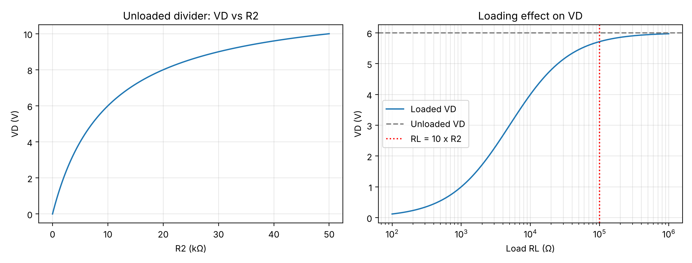
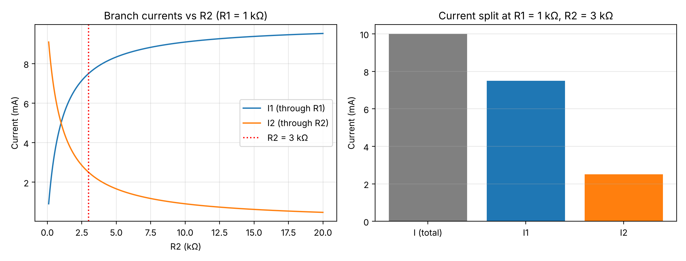
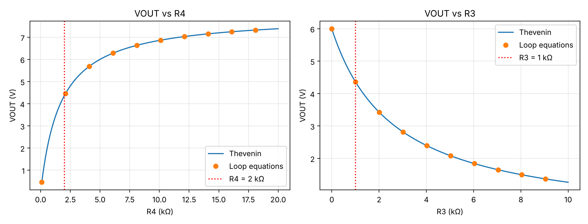
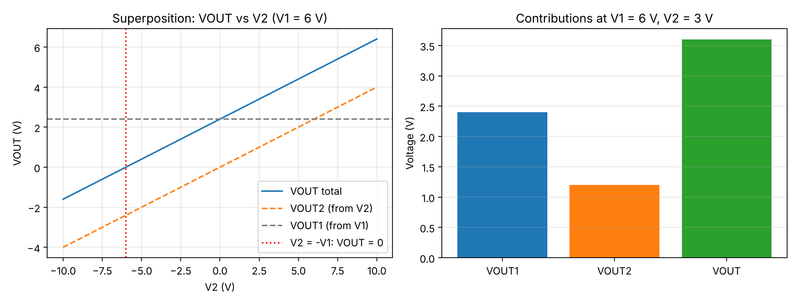
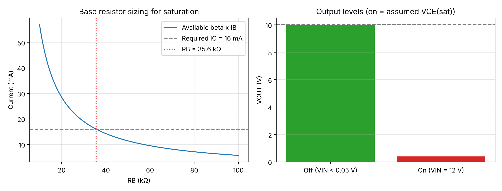
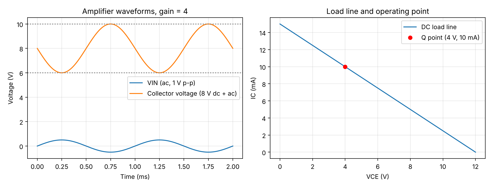

# Analog Circuit Models in Python

Six small models of basic analog circuits, written with NumPy and Matplotlib. Each script is a set of plain functions with no classes. It prints every calculation with the numbers substituted in, then plots the result and saves it as a PNG next to the script.

## Running

Install the two dependencies and run any script from its own folder.

```
pip install -r requirements.txt
python circuit1_voltage_divider.py
```

Each script prints its working to the terminal, saves a plot image, and opens the plot in a window.

## The circuits

**Voltage divider** (`circuit1_voltage_divider.py`) computes the output of a divider with V = 12 V and R1 = R2 = 10 kΩ, which is 6.000 V unloaded. It then adds a load ten times larger than R2 and shows the output falling to 5.714 V, an error of 4.76%.



**Current divider** (`circuit2_current_divider.py`) splits a 10 mA source between R1 = 1 kΩ and R2 = 3 kΩ, giving 7.500 mA and 2.500 mA. It checks the result against Kirchhoff's current law and against the equal voltage across both branches.



**Thevenin equivalent** (`circuit3_thevenin.py`) reduces a two-stage resistor network to VTH = 8.000 V and RTH = 666.7 Ω, which gives an output of 4.364 V. The same output is then found by solving the loop equations with `numpy.linalg.solve`, and the two agree across a sweep of R3 and R4.



**Superposition** (`circuit4_superposition.py`) finds the output of a two-source network by treating each source alone and adding the results, 2.400 V plus 1.200 V for 3.600 V. A single node equation confirms it, and the plot shows the output crossing zero when the two sources are equal and opposite.



**Saturated transistor switch** (`circuit5_saturated_transistor.py`) sizes a collector resistor of 2 kΩ and a base resistor of 35.6 kΩ so that a transistor with a current gain of 50 saturates while sinking a 10 mA load. The plot shows how the available collector current falls below what the load needs once the base resistor grows too large.



**Transistor amplifier** (`circuit6_transistor_amplifier.py`) designs the bias network and emitter resistors for a common-emitter amplifier with a gain of four. It then checks the DC operating point with the chosen resistor values and plots the amplified waveform and the load line.


